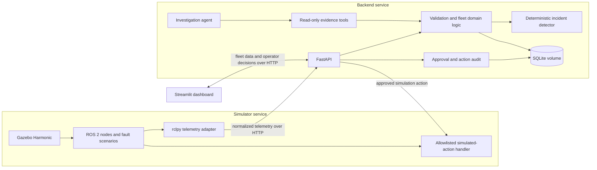

# Architecture

**Status:** MVP implementation is complete locally; public release checks remain. The headless simulator, telemetry ingestion, deterministic incident lifecycle, read-only investigation service, local Streamlit dashboard, and one operator-approved simulated reconnect workflow are implemented; Unit and API integration tests cover seeded scenario generation, telemetry validation, deterministic incident logic, duplicate-alert prevention, evidence handling, and the core recovery workflow.

## Overview

The MVP uses three Docker Compose services:

1. **Simulator:** Gazebo Harmonic, ROS 2 Jazzy robot nodes, reproducible fault scenarios, an rclpy telemetry adapter, and a restricted simulated-action handler.
2. **Backend:** FastAPI, telemetry validation, deterministic incident detection, SQLite persistence, investigation orchestration, read-only agent tools, operator approval checks, and audit records.
3. **Dashboard:** Streamlit operator interface for fleet health, telemetry history, incidents, recommendations, and explicit operator decisions.

ROS 2 communication stays inside the simulator service. The telemetry adapter sends normalized telemetry to the backend over HTTP. The dashboard also uses the backend API over HTTP. SQLite data and generated build output use Docker-managed volumes.

## Data flow

1. A seeded simulation run generates robot state and selected fault scenarios.
2. ROS 2 publishes robot state and fault data within the simulator service.
3. The adapter validates and normalizes messages, then sends accepted telemetry to the backend. Invalid or stale data must be visible as a data-quality condition.
4. The backend persists accepted telemetry and evaluates deterministic incident rules.
5. The dashboard reads fleet state and incident history through FastAPI.
6. For an incident, the agent gathers evidence through read-only tools and returns structured findings, hypotheses, confidence, and recommended next steps with evidence references.
7. An operator explicitly approves or rejects an allowlisted simulated action.
8. Only after approval does the backend request the simulated action and record its outcome.

## Safety and trust boundaries

- The agent cannot approve or execute actions and has no tool that sends control commands.
- The backend checks explicit operator approval before requesting a simulated action.
- Simulated actions may affect only scenario or mission state; they do not publish motor commands.
- The MVP has no physical-robot connection.
- Deterministic incident detection and tests work without a language model.
- Findings distinguish measured facts from hypotheses and retain evidence references.

## Implementation status

This document records the target design. The initial headless three-robot simulator, telemetry ingestion, deterministic incident lifecycle, read-only evidence investigation service, and local Streamlit dashboard are implemented. The simulated reconnect workflow is implemented. Automated tests validate telemetry, seeded scenario generation, incident rules, investigation evidence handling, and the recovery API/simulator policy in-process. A live disconnected-scenario recovery was previously reviewed; all fault scenarios have not yet been demonstrated through the running ROS/Gazebo stack in one validation session. Performance should be measured before increasing fleet size.
